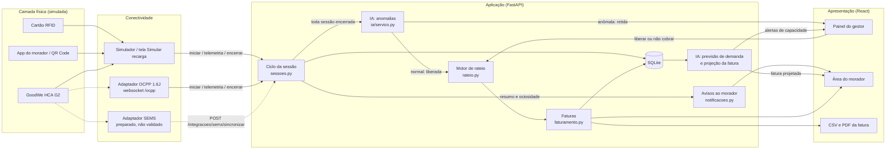
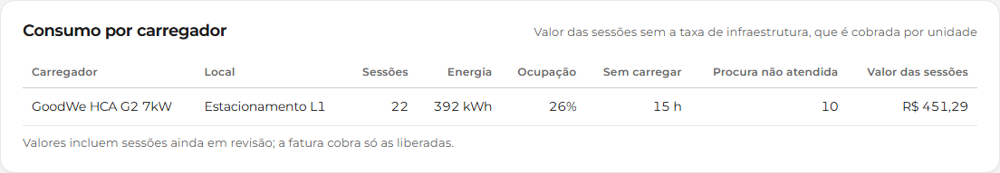
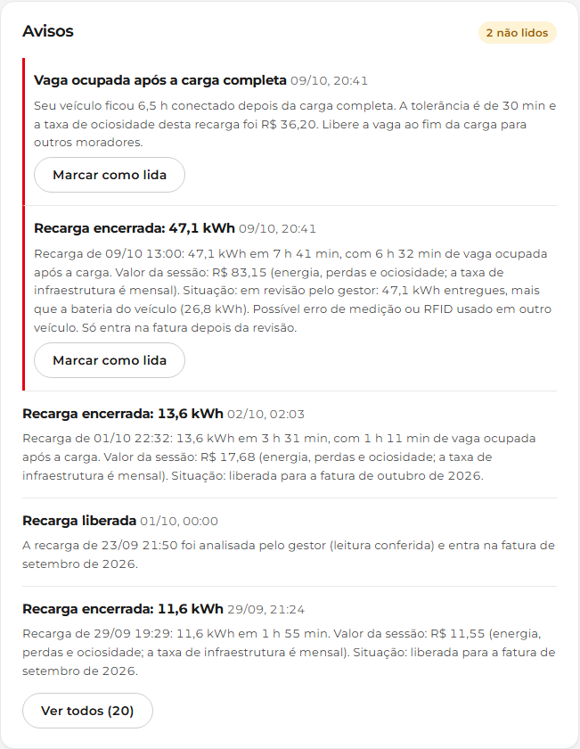

# EV ChargeOps — Enterprise Challenge 2026

> **Sprint 02 — Desenvolvimento e prototipação**
> Protótipo funcional da plataforma que transforma sessões de recarga de veículos elétricos em infraestrutura compartilhada com dados estruturados, rateio justo e inteligência acionável (GoodWe / FIAP).

- **Equipe:** FIAP 404
- **Sprint 01 (pesquisa e arquitetura):** https://github.com/FIAP-404/ev-chargeops-sprint01
- **Integrantes:** Fernando dos Santos Motta (RM570046), Joedson da Silva Souza (RM573981), Caetano de Medeiros Bona (RM569262), Erik Fabiano de Jesus Appe (RM571067), Mylena Ramalho da Silva Torquato (RM572383)

## Sumário

1. [O que foi implementado](#1-o-que-foi-implementado)
2. [Como executar](#2-como-executar)
3. [Arquitetura e fluxo](#3-arquitetura-e-fluxo)
4. [Lógica central: sessões e rateio](#4-lógica-central-sessões-e-rateio)
5. [Módulo de IA](#5-módulo-de-ia)
6. [Evidências de funcionamento](#6-evidências-de-funcionamento)
7. [Decisões técnicas](#7-decisões-técnicas)
8. [Desvios em relação à Sprint 01 e justificativas](#8-desvios-em-relação-à-sprint-01-e-justificativas)
9. [Limitações e próximos passos](#9-limitações-e-próximos-passos)
10. [Organização do repositório](#10-organização-do-repositório)
11. [Uso de IA no desenvolvimento](#11-uso-de-ia-no-desenvolvimento)

## 1. O que foi implementado

A Sprint 01 terminou com um plano de nove itens para a Sprint 02. O protótipo entrega os itens 2 a 9; o item 1 (configuração do repositório) foi cumprido em parte, como explicado na seção 8:

| Plano da Sprint 01 | Onde está | Situação |
|---|---|---|
| Configuração do repositório | `README.md`, `.github/`, histórico de commits | README final e commits no padrão Conventional Commits; sem issues nem board (seção 8) |
| Modelagem e banco de dados | `backend/app/models.py` | SQLite via SQLAlchemy (troca para PostgreSQL por variável de ambiente) |
| Back-end / API | `backend/app/main.py`, `backend/app/routers/` | FastAPI, documentação em `/docs` |
| Simulador de sessões | `backend/simulador/gerar_sessoes.py` | 27 semanas de uso de um condomínio com 12 unidades |
| Motor de rateio | `backend/app/rateio.py`, `backend/app/faturamento.py` | kWh × tarifa + perdas + taxa de infraestrutura + ociosidade − créditos |
| Dashboard do gestor | `frontend/src/paginas/PainelGestor.jsx`, `Faturas.jsx` | React + Recharts |
| Área do usuário | `frontend/src/paginas/AreaMorador.jsx` | Prévia da fatura, projeção, histórico e avisos |
| Módulo de IA | `backend/app/ia/` | Detecção de anomalias + previsão de demanda + projeção de fatura |
| Vídeo pitch e validação técnica | `docs/roteiro-pitch.md`; vídeo na seção 6 | Roteiro de 5 minutos e vídeo de demonstração do protótipo |

Também foram entregues pontos prometidos no texto e no diagrama da Sprint 01:

| Ponto da Sprint 01 | Onde está | Situação |
|---|---|---|
| Identificação por app / QR Code | `backend/app/sessoes.py` (`iniciar_sessao_app`), `frontend/src/paginas/SimularSessao.jsx` | QR fixo no carregador lido pelo app do morador; ~30% das sessões simuladas começam assim |
| Exportação de faturas | `backend/app/routers/faturas.py` (`GET /faturas/exportar.csv`), `frontend/src/estilos.css` (`@media print`) | CSV mensal (`;`, vírgula decimal, abre no Excel) e PDF pelo navegador |
| Arquitetura preparada para protocolos abertos | `backend/app/integracoes/ocpp16.py`, `backend/app/routers/ocpp.py`, `backend/app/routers/integracoes.py` | Subconjunto do OCPP 1.6J pelo websocket `/ocpp/{carregador_id}`, sem teste em hardware; SEMS ligado à API |
| Resumo da sessão e avisos ao morador | `backend/app/notificacoes.py`, `frontend/src/paginas/AreaMorador.jsx` | Caixa de avisos no app; enviador plugável (console hoje) |
| Relatório por carregador | `backend/app/routers/painel.py` (`consumo_por_carregador`), `PainelGestor.jsx` | Sessões, kWh, ocupação e valor por carregador no painel do gestor |

O ponto central do protótipo: **a IA participa do fluxo de cobrança.** Toda sessão encerrada passa pelo detector de anomalias, e é ele que decide se a sessão vai direto para o rateio ou fica retida até o gestor decidir. Sem essa etapa, nenhuma fatura é gerada.

## 2. Como executar

Pré-requisitos: Python 3.11 ou superior e Node.js 18 ou superior.

### 2.1 Back-end (API + banco + IA)

```bash
cd backend
python -m venv .venv
source .venv/bin/activate          # Windows: .venv\Scripts\activate
pip install -r requirements.txt

# gera o cenário das evidências (27 semanas até 13/10/2026 15:00), fecha as faturas e treina a IA (~15 s)
python -m simulador.gerar_sessoes --ate 2026-10-13T15:00

# sobe a API em http://localhost:8000 (documentação interativa em /docs)
uvicorn app.main:app --reload
```

Com a data fixa, os números deste README, do notebook e de `docs/evidencias/` saem iguais em qualquer dia; sem `--ate`, o histórico vai até agora e os números mudam.

Depois de atualizar o repositório, rode o simulador de novo: ele recria o banco (`backend/data/evchargeops.db`) com as colunas novas (`carregadores.qr_token`, `sessoes_recarga.metodo_identificacao`). Um banco gerado por uma versão anterior não ganha essas colunas sozinho e a API falha ao ler as sessões.

Variáveis opcionais (banco, pasta de dados, SEMS, endereço da API) estão em `.env.example`.

### 2.2 Front-end

Em outro terminal:

```bash
cd frontend
npm install
npm run dev                        # abre em http://localhost:5173
```

O Vite repassa as chamadas `/api/*` para `http://localhost:8000`. Se a API estiver em outro endereço, use `EVCO_API_URL=http://host:porta npm run dev`.

### 2.3 Testes e notebook

```bash
cd backend
python -m pytest -v                # 94 testes: rateio, fluxo de sessão, casos de borda, API, IA, SEMS e OCPP

cd ..
pip install nbformat nbclient ipykernel matplotlib
python scripts/gerar_notebook.py   # reexecuta notebooks/avaliacao_ia.ipynb
```

### 2.4 Opções do simulador

| Opção | Padrão | Para que serve |
|---|---|---|
| `--semanas` | 27 | tamanho do histórico |
| `--ate` | agora | data final (ex.: `2026-10-13T15:00`) |
| `--seed` | 42 | semente aleatória (mesma semente = mesmos dados) |
| `--fator-demanda` | 0,65 | escala a frequência de uso de todos os moradores |
| `--taxa-anomalias` | 0,07 | chance de uma anomalia injetada por dia |
| `--sem-roteiro` | — | não injeta as quatro ocorrências fixas dos últimos dias |

O simulador apaga e recria o banco a cada execução.

## 3. Arquitetura e fluxo

A arquitetura segue as quatro camadas definidas na Sprint 01 ([diagrama da Sprint 01, atualizado com o que foi implementado](docs/arquitetura-ev-chargeops.svg)). No protótipo, a camada física é representada pelo simulador (ou pela tela "Simular recarga"). Ele faz o papel do carregador e chama a mesma API que um gateway ligado ao HCA G2 chamaria. Um carregador com OCPP 1.6J pode se ligar direto pelo websocket `/ocpp/{carregador_id}`.



### 3.1 Ciclo de vida de uma sessão

| Etapa (Sprint 01, seção 5.2) | Rota | O que acontece |
|---|---|---|
| Usuário se identifica | `POST /sessoes/iniciar` (RFID) ou `POST /sessoes/iniciar-app` (QR + usuário do app) | RFID: o código do cartão vira hash SHA-256 e é buscado nas credenciais; cartão desconhecido abre a sessão, que vai para a quarentena. App: o morador lê o QR Code colado no carregador e o app envia o token com o usuário; o veículo é deduzido quando ele tem só um. O app nunca abre sessão anônima: QR inválido, usuário inativo ou sem unidade devolvem 403 e veículo de outro usuário (ou não informado, para quem tem dois) devolve 422. Nos dois caminhos, carregador ocupado devolve 409 e registra a tentativa (demanda não atendida); início sobreposto a uma sessão já encerrada ou leitura inicial abaixo da última do medidor devolvem 422. |
| Telemetria | `POST /sessoes/{id}/telemetria` | Grava potência, leitura do medidor e status. Leitura que "anda para trás" é ignorada e vira evento de erro; horário anterior ao início da sessão devolve 422. `carga_completa` marca o início da ociosidade. |
| Encerramento | `POST /sessoes/{id}/encerrar` | kWh = leitura final − inicial. Sem leitura final (falha de comunicação), usa o último dado válido. Calcula duração, ociosidade, potência média e status final. Horário ou leitura final anteriores à última telemetria devolvem 422. |
| Decisão de cobrança | automática | Sem identificação: `quarentena`. Identificada: a IA avalia e devolve `liberada` ou `revisao_ia`. |
| Usuário recebe resumo (passo 9) | automática; `GET /usuarios/{id}/notificacoes`, `POST /notificacoes/{id}/lida` | Resumo com kWh, duração, ociosidade, valor da sessão e situação (liberada ou em revisão, com o motivo). Ociosidade longa gera um aviso extra; a decisão do gestor também avisa o morador. Sessão em quarentena não notifica; se o gestor a atribuir a um morador, ele recebe o resumo nesse momento. |
| Revisão do gestor | `POST /sessoes/{id}/revisao` | Liberar (com crédito opcional, limitado ao valor da sessão, e, na quarentena, atribuindo um morador) ou não cobrar. |
| Fechamento do mês | `POST /faturas/gerar?mes=AAAA-MM` | Gera a fatura de cada unidade com as sessões liberadas do mês (o mês é o do início da sessão). Sessões em revisão ou ainda abertas são contadas como pendências (`fechada_com_pendencias`). Os parâmetros usados ficam gravados na fatura, e gerar o mesmo mês de novo os reaproveita. Encerrar ou revisar depois uma sessão de mês já faturado marca a fatura como `desatualizada`. Depois de gravar as faturas, a IA é retreinada com o histórico. |
| Carregador OCPP conecta | `WS /ocpp/{carregador_id}` (subprotocolo `ocpp1.6`) | StartTransaction abre a sessão (`transactionId` = id da sessão), MeterValues vira telemetria (Wh → kWh, W → kW), StatusNotification `SuspendedEV` marca carga completa e `Faulted` registra erro, StopTransaction encerra. O Stop sempre fecha a sessão: hora ou medidor inconsistentes caem no último dado válido. Valores por fase são ignorados (vale o total) e datas sem fuso são tratadas como UTC, como manda o OCPP. |
| Leitura do SEMS | `POST /integracoes/sems/sincronizar?carregador_id=` | Lê o carregador no SEMS e grava a leitura na sessão aberta. Sem `EVCO_SEMS_USUARIO`, `EVCO_SEMS_SENHA` e `EVCO_SEMS_PLANTA_ID` responde 503; falha do SEMS responde 502. |

Outras rotas: `GET /sessoes`, `GET /faturas`, `GET /faturas/exportar.csv?mes=AAAA-MM`, `GET/PUT /parametros`, `GET /dashboard/resumo` (KPIs do mês, consumo por unidade e por carregador), `GET /dashboard/historico-mensal`, `GET /usuarios/{id}/painel`, `GET /ia/status`, `POST /ia/treinar`, `GET /ia/previsao-capacidade`, `GET /ia/alertas`. Mês fora do formato AAAA-MM devolve 400. Todas estão documentadas em `http://localhost:8000/docs`.

## 4. Lógica central: sessões e rateio

### 4.1 Fórmula (a mesma da Sprint 01, seção 5.3)

```text
Valor da unidade no mês =
    kWh liberados × tarifa
  + perdas técnicas (% sobre a energia)
  + taxa fixa de infraestrutura (só para quem usou, salvo regra contrária)
  + ociosidade (minutos acima da tolerância × R$/hora, se a regra estiver ativa)
  − créditos concedidos pelo gestor
```

- Dinheiro é calculado com `Decimal` e cada parcela é arredondada em centavos (`ROUND_HALF_UP`). Assim 1,995 vira 2,00, como no exemplo da Sprint 01.
- O total nunca fica negativo, mesmo com crédito maior que o valor.
- O crédito que o gestor concede numa sessão tem teto: o valor da própria sessão (energia + perdas + ociosidade, sem a taxa mensal de infraestrutura), calculado pelo mesmo motor de rateio. A API recusa crédito acima disso (`test_fluxo_sessao.py`).
- Cada fatura grava a **memória de cálculo**: o texto de cada parcela ("42 kWh × R$ 0,95/kWh"). É isso que a tela mostra ao morador.
- **Regerar não reprecifica.** A fatura guarda os parâmetros usados em `memoria_calculo.parametros`, e uma nova geração do mesmo mês reaproveita esses parâmetros. Uma tarifa nova só vale para meses que ainda não foram fechados.
- **Datas com fuso.** A API aceita datas com fuso (`2026-08-03T22:10:00Z`, `2026-08-03T19:10:00-03:00`) e as converte para o horário local do servidor. Datas sem fuso já são tratadas como horário local.

### 4.2 Regras de exceção (Sprint 01, seção 5.4)

| Exceção | Como foi implementada | Teste |
|---|---|---|
| Sessão interrompida | Cobra só o kWh medido; `status_final = interrompida` | `test_fluxo_sessao.py` |
| Usuário que não carregou | Fatura zerada; a taxa fixa só é cobrada se `cobrar_infra_sem_uso` estiver ativo | `test_rateio.py` |
| Dois veículos na mesma unidade | Sessões separadas por RFID/veículo e consolidadas na fatura, com kWh por placa | `test_rateio.py` |
| Usuário sem identificação | Quarentena e alerta; o gestor atribui a sessão a um morador antes de cobrar. Só acontece pelo RFID; o app recusa o início em vez de abrir sessão anônima. | `test_fluxo_sessao.py` |
| Falha de comunicação | Usa a última leitura válida recebida | `test_fluxo_sessao.py` |
| Ociosidade após carga completa | Medida a partir do evento `carga_completa`; cobrada acima da tolerância | `test_rateio.py` |
| Falha do equipamento | Sessão retida; o gestor pode liberar com crédito | `test_fluxo_sessao.py` |

### 4.3 Parâmetros usados no cenário simulado

Tarifa R$ 0,95/kWh, perdas 5% e taxa de infraestrutura R$ 20,00 são os valores da Sprint 01. Também estão ativos tolerância de ociosidade de 30 min e R$ 6,00/h acima dela. Esses dois valores são da simulação e não foram aprovados por nenhum condomínio. Todos os parâmetros podem ser alterados na tela "Regras de rateio" ou em `PUT /parametros`.

## 5. Módulo de IA

A Sprint 01 definiu a IA v1 como "previsão simples de consumo e detecção estatística de anomalias", com modelos interpretáveis. Foram implementados três usos, e cada um alimenta uma decisão da plataforma:

| Uso | Técnica | Decisão que alimenta |
|---|---|---|
| Detecção de anomalias | Regras de negócio + Isolation Forest (scikit-learn) | Liberar a sessão para cobrança ou retê-la para o gestor |
| Previsão de demanda | Regressão de Poisson (dia × faixa do dia, hora, tendência semanal) | Alertas de capacidade e recomendação de segundo ponto |
| Projeção da fatura | Ritmo do mês combinado com a média de 8 semanas | Valor previsto mostrado ao morador |

### 5.1 Detecção de anomalias: a IA decide a cobrança

`encerrar_sessao()` chama `ia.avaliar_sessao_encerrada()` em toda sessão identificada. A avaliação combina:

1. **Regras de negócio** (explicáveis, valem desde o primeiro dia): kWh maior que a bateria do veículo, pico acima do limite do carregador, conectado sem carregar, falha do equipamento, consumo acima de 3 desvios e 1,5× a média do usuário, e ociosidade acima de 3 h.
2. **Isolation Forest**, treinado com o histórico. Ele olha a qualidade elétrica da recarga **em relação ao veículo**: fração da bateria carregada, potência média ÷ esperada, pico ÷ esperado e média ÷ pico. Uma sessão é marcada quando fica acima do percentil 97 do histórico. A mensagem diz quais variáveis se afastaram do típico.

Severidade média ou alta deixa a sessão em `revisao_ia`: ela não entra na fatura até o gestor decidir. Severidade baixa (ociosidade longa) só gera aviso, porque a taxa de ociosidade já é aplicada pelo rateio.

O modelo é retreinado sempre que as faturas de um mês são geradas (no simulador, a cada virada de mês), por `POST /ia/treinar` e na subida da API quando não há modelo salvo e já existem 40 sessões elegíveis. Com menos de 40 sessões no histórico ele fica desligado e só as regras atuam (cold start); o painel do gestor mostra "Modelo desligado (cold start)" com quantas sessões já existem. O modelo também não retém uma sessão com potência média entre 80% e 110% do esperado e pico até 110%: uma curva mais "reta" que o histórico, com a potência certa, não é defeito.

**Avaliação** (notebook, 5 simulações, 107 anomalias injetadas e 971 sessões normais):

| | Somente regras | Regras + Isolation Forest |
|---|---|---|
| Anomalias detectadas | 85 de 107 (79%) | 94 de 107 (88%) |
| Alarmes sem anomalia | 0 de 971 | 1 de 971 (0,1%) |

Antes da regra da potência dentro do esperado, eram 8 alarmes sem anomalia em 971; as detecções não mudaram.

O Isolation Forest acrescenta o caso que nenhuma regra descreve bem: o **cabo ou carregador degradado**. Nesse caso a potência fica muito baixa durante horas, mas o kWh e a duração são plausíveis. Depois do primeiro treino, o modelo encontrou 9 desses 12 casos.

### 5.2 Previsão de demanda

As chegadas por hora são as sessões mais as tentativas com o carregador ocupado. Quem tentou e carregou até 4 h depois conta uma vez só. A regressão de Poisson modela essas chegadas e é adequada para contagens. O termo de tendência mede o crescimento da procura (cerca de 2,8% por semana no cenário simulado). A ocupação prevista de cada faixa do dia é calculada como chegadas × duração média ÷ 6 h de capacidade por carregador. Faixas acima de 100% geram alerta com a sugestão de levar à assembleia um segundo ponto ou uma regra de agendamento.

Backtest com as últimas 4 semanas: erro de **34%** no total semanal, contra **49%** da média histórica simples. Por hora o modelo erra um pouco mais que a média histórica (0,135 contra 0,126 chegada/hora), porque as contagens são quase sempre 0 ou 1. Por isso a previsão é usada somada por faixa de 6 h, onde o erro semanal é 34% contra 49%: a média não enxerga o crescimento.

Com histórico ralo (alguma das 4 semanas de teste sem nenhuma chegada), a previsão não é treinada e o painel mostra que ela precisa de 8 semanas completas de histórico.

### 5.3 Projeção da fatura

Combina o ritmo de consumo do mês atual com a média das últimas 8 semanas. O peso do mês atual cresce com os dias decorridos. Essa fórmula foi escolhida por backtest (4 meses × dias 8, 15 e 22): erro médio de **24,8 kWh**, contra 26,8 kWh usando só o histórico e 27,8 kWh com a regra de três. A tela deixa claro que é uma estimativa e que o valor cobrado é sempre o medido.

Erro médio absoluto (kWh) por dia do mês em que a projeção foi feita:

| Dia | Mistura (sistema) | Só histórico | Regra de três |
|---|---|---|---|
| 8 | 37,1 | 36,7 | 46,6 |
| 15 | 23,5 | 27,8 | 22,7 |
| 22 | 13,8 | 15,8 | 14,1 |
| Geral | 24,8 | 26,8 | 27,8 |

No dia 8 a mistura não supera o histórico; a amostra é pequena (4 meses). No dia 15 a regra de três fica um pouco à frente.

## 6. Evidências de funcionamento

| Evidência | Arquivo |
|---|---|
| Notebook executado (rateio, anomalias, demanda, projeção) | [`notebooks/avaliacao_ia.ipynb`](notebooks/avaliacao_ia.ipynb) |
| Saída dos testes automatizados | [`docs/evidencias/testes.txt`](docs/evidencias/testes.txt) |
| Saída do simulador | [`docs/evidencias/simulador.txt`](docs/evidencias/simulador.txt) |
| Painel do gestor | [`docs/evidencias/01-painel-gestor.png`](docs/evidencias/01-painel-gestor.png) |
| Faturas com memória de cálculo | [`docs/evidencias/02-faturas.png`](docs/evidencias/02-faturas.png) |
| Área do morador | [`docs/evidencias/03-area-morador.png`](docs/evidencias/03-area-morador.png) |
| Recarga simulada pela API, retida pela IA | [`docs/evidencias/04-simular-recarga.png`](docs/evidencias/04-simular-recarga.png) |
| Regras de rateio | [`docs/evidencias/05-regras-rateio.png`](docs/evidencias/05-regras-rateio.png) |
| Área do morador no celular | [`docs/evidencias/06-area-morador-celular.png`](docs/evidencias/06-area-morador-celular.png) |
| Fatura em PDF (impressão do navegador) | [`docs/evidencias/07-fatura.pdf`](docs/evidencias/07-fatura.pdf) |
| CSV do mês para a administradora | [`docs/evidencias/faturas-2026-09.csv`](docs/evidencias/faturas-2026-09.csv) |
| Caixa de avisos do morador | [`docs/evidencias/08-avisos-morador.png`](docs/evidencias/08-avisos-morador.png) |
| Consumo por carregador no painel do gestor | [`docs/evidencias/09-consumo-por-carregador.png`](docs/evidencias/09-consumo-por-carregador.png) |
| Vídeo de demonstração (2-3 min) | LINK_DO_VIDEO (a gravar pela equipe) |

As capturas, a fatura em PDF e o CSV são gerados por `scripts/capturar_evidencias.py`, que usa Playwright com a API e o front-end rodando, sobre o cenário do simulador (`--ate 2026-10-13T15:00`, seed 42).

**Painel do gestor.** Decisões pendentes com o motivo de cada retenção (selo "Regra" ou "IA"), o crédito limitado ao valor da sessão, a capacidade prevista e o consumo do mês.


**Consumo por carregador.** Sessões, kWh, ociosidade, procura não atendida, ocupação e valor de cada carregador no mês.



**Faturas.** Rateio de todas as unidades no mês e, ao lado, a fatura explicável com a regra de cada parcela.


**Área do morador.** Previsão da IA para o fechamento do mês, recargas, faturas anteriores e a prévia da fatura.


**Avisos ao morador.** Ao encerrar cada recarga, o morador recebe o resumo (energia, duração, tempo na vaga após a carga, valor e situação da cobrança); a ociosidade longa e a decisão do gestor geram avisos próprios.



**Simular recarga.** Uma recarga com cabo defeituoso enviada pela API; a IA retém a cobrança e explica o motivo.


**Regras de rateio.** Parâmetros aprovados pelo condomínio, com o exemplo de 42 kWh recalculado ao vivo.


**Área do morador no celular.**


## 7. Decisões técnicas

- **FastAPI + SQLite + React (Vite) + Recharts.** Estão entre as opções listadas na Sprint 01. Python no back-end deixa a API e a IA (pandas, scikit-learn) no mesmo processo, então a IA é chamada diretamente no encerramento da sessão, sem serviço separado.
- **SQLAlchemy em vez de SQL puro**, para trocar SQLite por PostgreSQL só com a variável `EVCO_DB_URL`. A telemetria é guardada como eventos (tabela `eventos_sessao`), não em tabela própria de séries temporais.
- **Serviço de domínio separado das rotas.** `sessoes.py`, `faturamento.py` e `rateio.py` não dependem do FastAPI. O simulador, os testes e a API usam as mesmas funções, então o dado simulado percorre exatamente o caminho do dado real.
- **`rateio.py` é puro** (sem banco), o que permite testar a fórmula isoladamente.
- **Leitura de medidor em vez de kWh por intervalo.** O carregador reporta um contador acumulado, e o kWh da sessão é a diferença entre as leituras. Isso torna possível reconciliar falhas de comunicação e detectar leituras inválidas.
- **RFID guardado como hash**, como previsto na Sprint 01 (`codigo_rfid_hash`).
- **Protocolos abertos (RN ANEEL nº 1.000/2021, Art. 552): tradutor OCPP manual, sem a biblioteca `ocpp`.** A biblioteca é assíncrona e quer controlar a conexão; o tradutor é só mais um adaptador das mesmas três funções (iniciar / telemetria / encerrar), como o simulador e o SEMS. A tag desconhecida é aceita e a sessão vai para a quarentena, como no RFID. O idTag é o cartão lido pelo carregador, então a sessão fica com `metodo_identificacao = "rfid"`: o OCPP é o transporte, não o método. Carregador ocupado responde `ConcurrentTx`; erros usam só os códigos de CALLERROR da especificação 1.6. O StopTransaction sempre fecha a sessão, porque um Stop recusado deixaria a sessão aberta e o carregador preso.
- **Variáveis da IA escolhidas por teste.** A primeira versão do Isolation Forest usava duração, kWh e tempo ocioso. Na avaliação, a ociosidade dominava o modelo (12 alarmes falsos) e recargas curtas legítimas viravam alarme. A versão final usa razões relativas ao veículo. O histórico de commits mostra essa evolução.
- **Sessões já apontadas pela IA não treinam o modelo**, mesmo que o gestor libere a cobrança. Sem isso, cada cabo defeituoso liberado ensinava ao modelo que aquele padrão é normal.
- **Retreino no fechamento do mês.** `POST /faturas/gerar` retreina os modelos depois de gravar as faturas. Se o treino falhar, a fatura continua gerada e o retreino acontece no próximo fechamento. Na subida da API, um banco com histórico mas sem modelo salvo é treinado na hora.
- **Tentativas com carregador ocupado viram dado.** Com um único carregador, só as sessões esconderiam a demanda reprimida, e a previsão de capacidade ficaria cega para a fila.
- **Identidade visual inspirada na GoodWe.** Um único vermelho de marca, usado só em ações, item ativo e energia; neutros sem matiz; botões em pílula com o gradiente coral → vermelho. Os gráficos seguem a convenção das ilustrações da GoodWe: vermelho para energia medida e violeta para previsões da IA. O status crítico é vinho, para não competir com o vermelho de ação.
- **Botões com regras de design system** (Material 3, Carbon, Polaris), documentadas em `estilos.css`: no máximo um primário por grupo, altura única de 40 px, desabilitado neutro e sempre explicado.
- **Campo de dinheiro no padrão dos apps bancários.** Só aceita dígitos e os centavos entram pela direita (1124 → R$ 11,24); o valor é guardado em centavos inteiros.
- **Fonte servida pelo próprio app** (`@fontsource-variable/montserrat`), para funcionar sem internet.

## 8. Desvios em relação à Sprint 01 e justificativas

| Planejado na Sprint 01 | O que foi feito | Por quê |
|---|---|---|
| Configuração do repositório: "README final, issues, board e padrões de commit" | README final e commits no padrão Conventional Commits (`feat`, `fix`, `docs`, `refactor`, `test`, `chore`, com escopo), descrito na seção 10.1, e modelo de Pull Request em `.github/`. Issues e board não foram criados | A ordem de desenvolvimento da seção 6 da Sprint 01 serviu de backlog, e cada item corresponde a commits com escopo identificável (`banco`, `rateio`, `ia`, `api`, `simulador`, `front`). |
| Integração com SEMS/GoodWe "se autorizado" | Dados simulados. O adaptador SEMS (`app/integracoes/sems.py`) está implementado e testado com um JSON de exemplo, mas não foi validado com dados reais, e ligado à API pela rota `POST /integracoes/sems/sincronizar` | A exploração da Sprint 01 não encontrou histórico de sessões por usuário no retorno do SEMS. A própria Sprint 01 previu esse fallback. |
| Arquitetura "preparada para protocolos abertos" (seção 8; RN ANEEL nº 1.000/2021, Art. 552) | Subconjunto do OCPP 1.6J, sem teste em hardware: BootNotification, Heartbeat, Authorize, StartTransaction, MeterValues, StatusNotification e StopTransaction pelo websocket `/ocpp/{carregador_id}` | O HCA G2 do laboratório é acessado pelo SEMS (nuvem proprietária) e não houve carregador ou gateway OCPP para validar. O tradutor entra como mais um adaptador das mesmas três funções da sessão, sem alterar o rateio nem a IA. |
| "Fila de eventos" (`session_started`, `meter_tick`) no diagrama de arquitetura | Ingestão síncrona por REST; cada mudança grava um evento na tabela `eventos_sessao` (`inicio`, `telemetria`, `carga_completa`, `erro`, `fim`, `revisao`) na mesma transação da sessão | Com um carregador e uma leitura por minuto, uma fila só acrescentaria um processo e consistência eventual. No fluxo síncrono, a decisão da IA sai na resposta do encerramento e cada evento é auditável na ordem em que ocorreu. A tabela já tem o formato de um *outbox*: um *worker* ou broker (ex.: MQTT/Redis) pode consumi-la depois sem mudar o esquema. |
| Base operacional "PostgreSQL / Timescale" no diagrama | SQLite via SQLAlchemy; a telemetria fica em `eventos_sessao`, indexada por sessão | A Sprint 01 (seção 6) já previa "SQLite para protótipo local". Com um carregador o volume é de milhares de linhas, sem necessidade de hypertable, e o projeto roda sem Docker. A troca para PostgreSQL é só a variável `EVCO_DB_URL`; TimescaleDB entra quando houver vários carregadores, com `create_hypertable` em `eventos_sessao`. |
| Abordagens 3 (clustering de perfis) e 4 (interface conversacional) de IA | Não implementadas | A Sprint 01 definiu a IA v1 como previsão + anomalias. Priorizamos IA que decide algo no fluxo em vez de quatro técnicas superficiais. |
| Abordagem 1 citava "regressão ou séries temporais simples" | Regressão de Poisson | É uma regressão adequada a contagens (chegadas por hora) e continua interpretável: cada coeficiente é o efeito de um dia/faixa/hora. |
| APIs complementares (Open Charge Map, Google Places, ANEEL) | Não integradas | Foram marcadas como opcionais e não fazem parte da lógica central de sessão e rateio. |
| Login para usuário e gestor | Sem autenticação; a área do morador tem um seletor "Ver como" | Fora do escopo de um protótipo de lógica e IA; será necessário antes de qualquer uso real. |
| Identificação por RFID, aplicativo ou QR Code (seções 3.2 e 5.2, slide "Identifica") | RFID e app/QR. O QR é fixo, colado no carregador, e o app envia o token junto com o `usuario_id`. A "liberação pelo gestor" existe como revisão da quarentena | Sem login, o usuário do app é o escolhido na tela (como o "Ver como" da área do morador). O ciclo de vida é o mesmo: as duas entradas usam a mesma função interna (`_abrir_sessao`), com as mesmas validações de sobreposição, medidor e carregador ocupado, e a IA e o rateio não mudam. |
| Passo 9 "usuário recebe resumo" e aviso de ociosidade | Caixa de avisos na Área do morador + interface `Enviador` (`EnviadorConsole`, uma linha de log por aviso) | Canal real (WhatsApp/e-mail/push) exige provedor e cadastro de contato; fica plugável. |
| Exportação "boleto" | CSV mensal para a administradora + fatura imprimível/PDF pelo navegador; sem emissão de boleto | Emitir boleto exige convênio bancário/PSP. No condomínio, a administradora lança o valor da recarga no boleto condominial a partir do CSV. |
| Relatório por carregador | Implementado (`consumo_por_carregador`), mas o cenário simulado tem um único carregador; a separação é coberta por teste com dois | Um segundo carregador na simulação mudaria a disputa e a recomendação da IA de "segundo ponto". |
| Esquema de dados da seção 5.6 | Mantido, com acréscimos: `usuario.unidade_id`, `veiculo.potencia_ac_max_kw`, `credencial.veiculo_id`, `carregador.qr_token`; na sessão, campos de cobrança, IA e `metodo_identificacao`; na fatura, `qtd_sessoes`, `valor_perdas`, `sessoes_pendentes` e `memoria_calculo` (parcelas e parâmetros usados); tabelas `parametros_rateio`, `alertas_ia`, `tentativas_ocupado` e `notificacoes`. O perfil `visitante` não foi implementado | Cada acréscimo atende a uma regra: ligar sessão à unidade, saber a potência esperada, separar veículos, registrar o meio de identificação, explicar e congelar o cálculo da fatura, reter sessões, medir a demanda reprimida e avisar o morador. Visitante sem cadastro cai na quarentena (cartão desconhecido), e o gestor decide a quem atribuir. |
| Taxa de ociosidade "dependendo de regra interna" | Ativa no cenário simulado (30 min de tolerância, R$ 6/h) e desligável | Mostra a regra funcionando; o valor real depende de aprovação do condomínio. |
| Roteiro de pitch de 3 minutos | Roteiro de 5 minutos | O enunciado da Sprint 02 define vídeo de 5 minutos na prova presencial. |

## 9. Limitações e próximos passos

- **Dados simulados.** Os modelos e o corte de 97% precisam ser recalibrados com sessões reais do HCA G2. Pendente: confirmar com a FIAP/GoodWe se o SEMS libera telemetria do EV Charger.
- **SEMS ainda sem dado real.** A rota existe, mas os nomes de campos do retorno em `integracoes/sems.py` continuam a confirmar.
- **OCPP sem segurança e só com o básico.** Sem TLS nem autenticação do carregador (Security Profiles do OCPP), sem comandos do Central System (RemoteStartTransaction, SetChargingProfile, Reset). Amostras por fase do MeterValues são descartadas: um carregador que reporte só valores por fase perde a energia e a potência. O suporte do HCA G2 a OCPP ainda precisa ser confirmado com a GoodWe.
- **QR estático pode ser copiado.** Quem fotografar o adesivo consegue iniciar uma recarga em nome de qualquer morador, porque a API confia no `usuario_id` enviado pelo app. O próximo passo é um token rotativo/assinado exibido no carregador, validado junto com um login real.
- **Um carregador.** O modelo e o painel (consumo por carregador) suportam vários, mas a simulação e a previsão de capacidade foram testadas só com um.
- **Cold start.** Até o histórico ter 40 sessões elegíveis, só as regras avaliam as sessões; o painel do gestor avisa. Quando o histórico chega a 40, o modelo é treinado na próxima geração de faturas, por `POST /ia/treinar` ou na próxima subida da API. A previsão de demanda precisa de 8 semanas completas.
- **Potência baixa sem regra própria.** O cabo degradado depende só do Isolation Forest (9 de 12 casos depois do primeiro treino). Uma regra de potência baixa pegaria os 16 casos, mas apagaria a medição do ganho do modelo e mudaria a base de treino; fica como próximo passo, junto com variar a curva de potência no simulador (hoje toda recarga normal fica entre 93% e 99% da potência do veículo, com redução só nos últimos 20 min; variar isso muda o sorteio e todos os números publicados).
- **Saltos de medidor menores que a folga da bateria** podem passar. Para pegá-los seria preciso comparar com o estado de carga do veículo ou com a leitura do SEMS.
- **Sem autenticação nem controle de acesso** por perfil.
- Próximos passos: validar o SEMS, testar o OCPP com um carregador ou simulador de carregador real, clustering de perfis para políticas de horário, agendamento de vagas e canal real de envio dos avisos (WhatsApp, e-mail ou push).

## 10. Organização do repositório

```text
.github/
  pull_request_template.md   modelo de Pull Request
.env.example            variáveis de ambiente opcionais
backend/
  app/
    main.py             API FastAPI (ponto de entrada)
    models.py           tabelas do banco
    database.py         conexão (SQLite por padrão)
    sessoes.py          ciclo de vida da sessão e decisão de cobrança
    rateio.py           motor de rateio (cálculo puro)
    faturamento.py      fechamento do mês por unidade
    notificacoes.py     avisos ao morador (resumo da sessão, ociosidade, revisão)
    seed.py             cadastro do condomínio simulado
    schemas.py          validação das entradas da API
    serializacao.py     conversão para JSON
    routers/            rotas HTTP (sessões, faturas, painéis, IA, avisos, integrações, OCPP)
    ia/
      anomalias.py      regras + Isolation Forest
      previsao.py       previsão de demanda e projeção da fatura
      servico.py        integração da IA com o fluxo
    integracoes/
      sems.py           adaptador GoodWe SEMS (não validado)
      ocpp16.py         tradutor OCPP 1.6J (subconjunto, sem teste em hardware)
  simulador/            gerador de 6 meses de uso
  tests/                94 testes (pytest)
frontend/
  src/paginas/          telas (gestor, faturas, morador, simulação, regras)
  src/componentes/      fatura explicável, gráficos, mapa de calor, decisões, campo em reais
notebooks/
  avaliacao_ia.ipynb    avaliação executada do rateio e da IA
docs/
  evidencias/           capturas de tela e saídas
  guia-do-codigo.md     guia de estudo do código para a equipe
  roteiro-pitch.md      roteiro do vídeo de 5 minutos
scripts/                geração do notebook e das capturas
```

### 10.1 Padrão de commits

Os commits seguem o Conventional Commits, em português: `tipo(escopo): descrição`. Tipos: `feat`, `fix`, `test`, `docs`, `refactor`, `chore`. Escopos usados: `banco`, `sessoes`, `rateio`, `faturas`, `ia`, `api`, `simulador`, `front`, `painel`, `notificacoes`, `ocpp`, `sems`. Exemplos: `feat(ocpp): tradutor OCPP 1.6J para o ciclo da sessão`, `fix(faturas): sessão aberta no fechamento entra como pendência`. Pull Requests usam o modelo `.github/pull_request_template.md`.

## 11. Uso de IA no desenvolvimento

Usamos um assistente de programação com IA (Claude, da Anthropic) para revisar o código e apontar bugs, sugerir casos de teste, apoiar a implementação de partes do back-end e do front-end e revisar o texto da documentação. Todo trecho sugerido foi lido, executado e testado pela equipe antes do commit. As decisões de arquitetura, as regras de rateio, os parâmetros e a avaliação do módulo de IA são da equipe. O `docs/guia-do-codigo.md` serve para que cada integrante consiga explicar qualquer parte do código.
