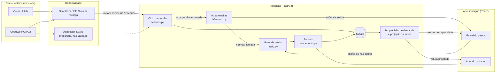
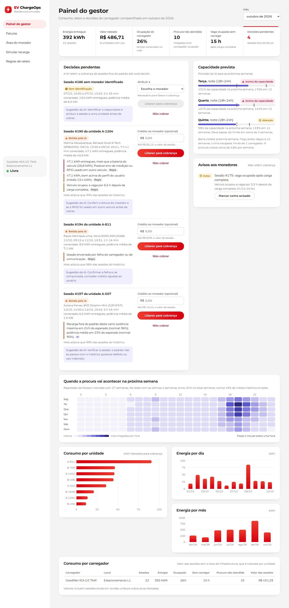
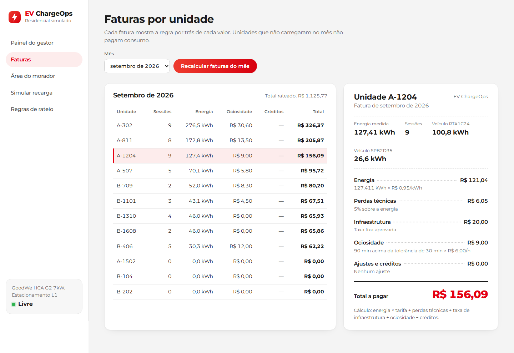
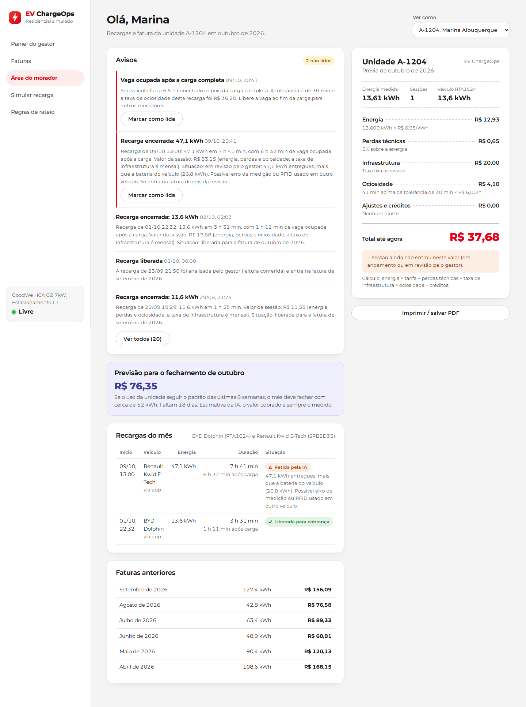
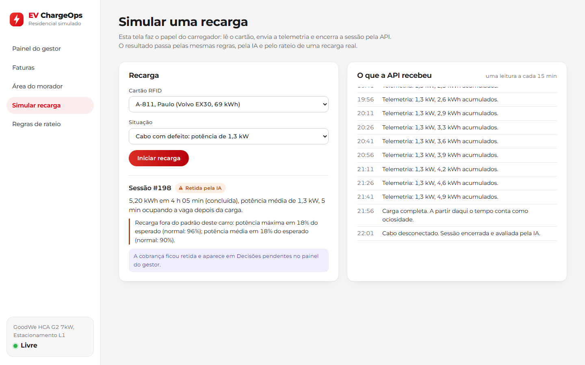
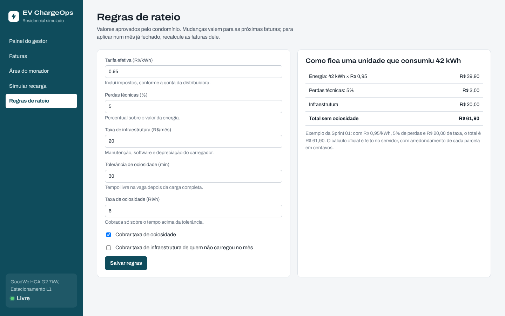
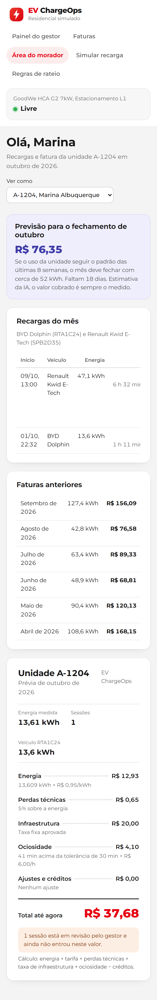

# EV ChargeOps — Enterprise Challenge 2026

> **Sprint 02 — Desenvolvimento e prototipação**
> Protótipo funcional da plataforma que transforma sessões de recarga de veículos elétricos em infraestrutura compartilhada com dados estruturados, rateio justo e inteligência acionável (GoodWe / FIAP).

- **Equipe:** FIAP 404
- **Sprint 01 (pesquisa e arquitetura):** https://github.com/FIAP-404/ev-chargeops-sprint01
- **Integrantes:** Fernando dos Santos Motta (RM570046), Joedson da Silva Souza (RM573981), Caetano de Medeiros Bona (RM569262), Erik Fabiano de Jesus Appe (RM571067), Mylena Ramalho da Silva Torquato (RM572383)

## Sumário

1. [O que foi implementado](#1-o-que-foi-implementado)
2. [Como executar](#2-como-executar)
3. [Arquitetura e fluxo](#3-arquitetura-e-fluxo)
4. [Lógica central: sessões e rateio](#4-lógica-central-sessões-e-rateio)
5. [Módulo de IA](#5-módulo-de-ia)
6. [Evidências de funcionamento](#6-evidências-de-funcionamento)
7. [Decisões técnicas](#7-decisões-técnicas)
8. [Desvios em relação à Sprint 01 e justificativas](#8-desvios-em-relação-à-sprint-01-e-justificativas)
9. [Limitações e próximos passos](#9-limitações-e-próximos-passos)
10. [Organização do repositório](#10-organização-do-repositório)

## 1. O que foi implementado

A Sprint 01 terminou com um plano de oito itens para a Sprint 02. O protótipo entrega todos eles:

| Plano da Sprint 01 | Onde está | Situação |
|---|---|---|
| Modelagem e banco de dados | `backend/app/models.py` | SQLite via SQLAlchemy (troca para PostgreSQL por variável de ambiente) |
| Back-end / API | `backend/app/main.py`, `backend/app/routers/` | FastAPI, documentação em `/docs` |
| Simulador de sessões | `backend/simulador/gerar_sessoes.py` | 27 semanas de uso de um condomínio com 12 unidades |
| Motor de rateio | `backend/app/rateio.py`, `backend/app/faturamento.py` | kWh × tarifa + perdas + taxa de infraestrutura + ociosidade − créditos |
| Dashboard do gestor | `frontend/src/paginas/PainelGestor.jsx`, `Faturas.jsx` | React + Recharts |
| Área do usuário | `frontend/src/paginas/AreaMorador.jsx` | Prévia da fatura, projeção e histórico |
| Módulo de IA | `backend/app/ia/` | Detecção de anomalias + previsão de demanda + projeção de fatura |
| Vídeo pitch e validação técnica | `docs/roteiro-pitch.md` | Roteiro de 5 minutos para a prova presencial |

O ponto central do protótipo: **a IA participa do fluxo de cobrança.** Toda sessão encerrada passa pelo detector de anomalias, e é ele que decide se a sessão vai direto para o rateio ou fica retida até o gestor decidir. Sem essa etapa, nenhuma fatura é gerada.

## 2. Como executar

Pré-requisitos: Python 3.11 ou superior e Node.js 18 ou superior.

### 2.1 Back-end (API + banco + IA)

```bash
cd backend
python -m venv .venv
source .venv/bin/activate          # Windows: .venv\Scripts\activate
pip install -r requirements.txt

# gera 6 meses de dados simulados até agora, fecha as faturas e treina a IA (~15 s)
python -m simulador.gerar_sessoes

# sobe a API em http://localhost:8000 (documentação interativa em /docs)
uvicorn app.main:app --reload
```

### 2.2 Front-end

Em outro terminal:

```bash
cd frontend
npm install
npm run dev                        # abre em http://localhost:5173
```

O Vite repassa as chamadas `/api/*` para `http://localhost:8000`. Se a API estiver em outro endereço, use `EVCO_API_URL=http://host:porta npm run dev`.

### 2.3 Testes e notebook

```bash
cd backend
python -m pytest -v                # 24 testes: rateio, fluxo de sessão, API e SEMS

cd ..
pip install nbformat nbclient ipykernel matplotlib
python scripts/gerar_notebook.py   # reexecuta notebooks/avaliacao_ia.ipynb
```

### 2.4 Opções do simulador

| Opção | Padrão | Para que serve |
|---|---|---|
| `--semanas` | 27 | tamanho do histórico |
| `--ate` | agora | data final (ex.: `2026-10-13T15:00`) |
| `--seed` | 42 | semente aleatória (mesma semente = mesmos dados) |
| `--fator-demanda` | 0,65 | escala a frequência de uso de todos os moradores |
| `--taxa-anomalias` | 0,07 | chance de uma anomalia injetada por dia |
| `--sem-roteiro` | — | não injeta as quatro ocorrências fixas dos últimos dias |

O simulador apaga e recria o banco a cada execução.

## 3. Arquitetura e fluxo

A arquitetura segue as quatro camadas definidas na Sprint 01 ([diagrama original](docs/arquitetura-ev-chargeops.svg)). No protótipo, a camada física é representada pelo simulador (ou pela tela "Simular recarga"). Ele faz o papel do carregador e chama a mesma API que um gateway ligado ao HCA G2 chamaria.



### 3.1 Ciclo de vida de uma sessão

| Etapa (Sprint 01, seção 5.2) | Rota | O que acontece |
|---|---|---|
| Usuário se identifica | `POST /sessoes/iniciar` | O código do RFID vira hash SHA-256 e é buscado nas credenciais. Se o carregador estiver ocupado, devolve 409 e registra a tentativa (demanda não atendida). |
| Telemetria | `POST /sessoes/{id}/telemetria` | Grava potência, leitura do medidor e status. Leitura que "anda para trás" é ignorada e vira evento de erro. `carga_completa` marca o início da ociosidade. |
| Encerramento | `POST /sessoes/{id}/encerrar` | kWh = leitura final − inicial. Sem leitura final (falha de comunicação), usa o último dado válido. Calcula duração, ociosidade, potência média e status final. |
| Decisão de cobrança | automática | Sem identificação: `quarentena`. Identificada: a IA avalia e devolve `liberada` ou `revisao_ia`. |
| Revisão do gestor | `POST /sessoes/{id}/revisao` | Liberar (com crédito opcional, limitado ao valor da sessão, e, na quarentena, atribuindo um morador) ou não cobrar. |
| Fechamento do mês | `POST /faturas/gerar?mes=AAAA-MM` | Gera a fatura de todas as unidades com as sessões liberadas. As pendentes ficam de fora e são contadas na fatura. |

Outras rotas: `GET /sessoes`, `GET /faturas`, `GET/PUT /parametros`, `GET /dashboard/resumo`, `GET /dashboard/historico-mensal`, `GET /usuarios/{id}/painel`, `GET /ia/status`, `POST /ia/treinar`, `GET /ia/previsao-capacidade`, `GET /ia/alertas`. Todas estão documentadas em `http://localhost:8000/docs`.

## 4. Lógica central: sessões e rateio

### 4.1 Fórmula (a mesma da Sprint 01, seção 5.3)

```text
Valor da unidade no mês =
    kWh liberados × tarifa
  + perdas técnicas (% sobre a energia)
  + taxa fixa de infraestrutura (só para quem usou, salvo regra contrária)
  + ociosidade (minutos acima da tolerância × R$/hora, se a regra estiver ativa)
  − créditos concedidos pelo gestor
```

- Dinheiro é calculado com `Decimal` e cada parcela é arredondada em centavos (`ROUND_HALF_UP`). Assim 1,995 vira 2,00, como no exemplo da Sprint 01.
- O total nunca fica negativo, mesmo com crédito maior que o valor.
- O crédito que o gestor concede numa sessão tem teto: o valor da própria sessão (energia + perdas + ociosidade, sem a taxa mensal de infraestrutura), calculado pelo mesmo motor de rateio. A API recusa crédito acima disso (`test_fluxo_sessao.py`).
- Cada fatura grava a **memória de cálculo**: o texto de cada parcela ("42 kWh × R$ 0,95/kWh"). É isso que a tela mostra ao morador.

### 4.2 Regras de exceção (Sprint 01, seção 5.4)

| Exceção | Como foi implementada | Teste |
|---|---|---|
| Sessão interrompida | Cobra só o kWh medido; `status_final = interrompida` | `test_fluxo_sessao.py` |
| Usuário que não carregou | Fatura zerada; a taxa fixa só é cobrada se `cobrar_infra_sem_uso` estiver ativo | `test_rateio.py` |
| Dois veículos na mesma unidade | Sessões separadas por RFID/veículo e consolidadas na fatura, com kWh por placa | `test_rateio.py` |
| Usuário sem identificação | Quarentena e alerta; o gestor atribui a sessão a um morador antes de cobrar | `test_fluxo_sessao.py` |
| Falha de comunicação | Usa a última leitura válida recebida | `test_fluxo_sessao.py` |
| Ociosidade após carga completa | Medida a partir do evento `carga_completa`; cobrada acima da tolerância | `test_rateio.py` |
| Falha do equipamento | Sessão retida; o gestor pode liberar com crédito | `test_fluxo_sessao.py` |

### 4.3 Parâmetros usados no cenário simulado

Tarifa R$ 0,95/kWh, perdas 5% e taxa de infraestrutura R$ 20,00 são os valores da Sprint 01. Também estão ativos tolerância de ociosidade de 30 min e R$ 6,00/h acima dela. Esses dois valores são da simulação e não foram aprovados por nenhum condomínio. Todos os parâmetros podem ser alterados na tela "Regras de rateio" ou em `PUT /parametros`.

## 5. Módulo de IA

A Sprint 01 definiu a IA v1 como "previsão simples de consumo e detecção estatística de anomalias", com modelos interpretáveis. Foram implementados três usos, e cada um alimenta uma decisão da plataforma:

| Uso | Técnica | Decisão que alimenta |
|---|---|---|
| Detecção de anomalias | Regras de negócio + Isolation Forest (scikit-learn) | Liberar a sessão para cobrança ou retê-la para o gestor |
| Previsão de demanda | Regressão de Poisson (dia × faixa do dia, hora, tendência semanal) | Alertas de capacidade e recomendação de segundo ponto |
| Projeção da fatura | Ritmo do mês combinado com a média de 8 semanas | Valor previsto mostrado ao morador |

### 5.1 Detecção de anomalias: o papel estrutural

`encerrar_sessao()` chama `ia.avaliar_sessao_encerrada()` em toda sessão identificada. A avaliação combina:

1. **Regras de negócio** (explicáveis, valem desde o primeiro dia): kWh maior que a bateria do veículo, pico acima do limite do carregador, conectado sem carregar, falha do equipamento, consumo acima de 3 desvios e 1,5× a média do usuário, e ociosidade acima de 3 h.
2. **Isolation Forest**, treinado com o histórico. Ele olha a qualidade elétrica da recarga **em relação ao veículo**: fração da bateria carregada, potência média ÷ esperada, pico ÷ esperado e média ÷ pico. Uma sessão é marcada quando fica acima do percentil 97 do histórico. A mensagem diz quais variáveis se afastaram do típico.

Severidade média ou alta deixa a sessão em `revisao_ia`: ela não entra na fatura até o gestor decidir. Severidade baixa (ociosidade longa) só gera aviso, porque a taxa de ociosidade já é aplicada pelo rateio. O modelo é retreinado a cada virada de mês. Com menos de 40 sessões no histórico, ele fica desligado e só as regras atuam (cold start).

**Avaliação** (notebook, 5 simulações, 107 anomalias injetadas e 971 sessões normais):

| | Somente regras | Regras + Isolation Forest |
|---|---|---|
| Anomalias detectadas | 85 de 107 (79%) | 94 de 107 (88%) |
| Alarmes sem anomalia | 0 de 971 | 8 de 971 (0,8%) |

O Isolation Forest acrescenta o caso que nenhuma regra descreve bem: o **cabo ou carregador degradado**. Nesse caso a potência fica muito baixa durante horas, mas o kWh e a duração são plausíveis. Depois do primeiro treino, o modelo encontrou 9 desses 12 casos.

### 5.2 Previsão de demanda

As chegadas por hora são as sessões mais as tentativas com o carregador ocupado. Quem tentou e carregou até 4 h depois conta uma vez só. A regressão de Poisson modela essas chegadas e é adequada para contagens. O termo de tendência mede o crescimento da procura (cerca de 2,8% por semana no cenário simulado). A ocupação prevista de cada faixa do dia é calculada como chegadas × duração média ÷ 6 h de capacidade por carregador. Faixas acima de 100% geram alerta com a sugestão de levar à assembleia um segundo ponto ou uma regra de agendamento.

Backtest com as últimas 4 semanas: erro de **34%** no total semanal, contra **49%** da média histórica simples. Por hora, as contagens são quase sempre 0 ou 1 e os dois erram parecido. O ganho está no total, porque a média não enxerga o crescimento.

### 5.3 Projeção da fatura

Combina o ritmo de consumo do mês atual com a média das últimas 8 semanas. O peso do mês atual cresce com os dias decorridos. Essa fórmula foi escolhida por backtest (4 meses × dias 8, 15 e 22): erro médio de **24,8 kWh**, contra 26,8 kWh usando só o histórico e 27,8 kWh com a regra de três. A tela deixa claro que é uma estimativa e que o valor cobrado é sempre o medido.

## 6. Evidências de funcionamento

| Evidência | Arquivo |
|---|---|
| Notebook executado (rateio, anomalias, demanda, projeção) | [`notebooks/avaliacao_ia.ipynb`](notebooks/avaliacao_ia.ipynb) |
| Saída dos testes automatizados | [`docs/evidencias/testes.txt`](docs/evidencias/testes.txt) |
| Saída do simulador | [`docs/evidencias/simulador.txt`](docs/evidencias/simulador.txt) |
| Painel do gestor | [`docs/evidencias/01-painel-gestor.png`](docs/evidencias/01-painel-gestor.png) |
| Faturas com memória de cálculo | [`docs/evidencias/02-faturas.png`](docs/evidencias/02-faturas.png) |
| Área do morador | [`docs/evidencias/03-area-morador.png`](docs/evidencias/03-area-morador.png) |
| Recarga simulada pela API, retida pela IA | [`docs/evidencias/04-simular-recarga.png`](docs/evidencias/04-simular-recarga.png) |
| Regras de rateio | [`docs/evidencias/05-regras-rateio.png`](docs/evidencias/05-regras-rateio.png) |
| Área do morador no celular | [`docs/evidencias/06-area-morador-celular.png`](docs/evidencias/06-area-morador-celular.png) |

As capturas são geradas por `scripts/capturar_evidencias.py`, que usa Playwright com a API e o front-end rodando, sobre o cenário do simulador (`--ate 2026-10-13T15:00`, seed 42).

**Painel do gestor.** Decisões pendentes com o motivo de cada retenção (selo "Regra" ou "IA"), o crédito limitado ao valor da sessão, a capacidade prevista e o consumo do mês.



**Faturas.** Rateio de todas as unidades no mês e, ao lado, a fatura explicável com a regra de cada parcela.



**Área do morador.** Previsão da IA para o fechamento do mês, recargas, faturas anteriores e a prévia da fatura.



**Simular recarga.** Uma recarga com cabo defeituoso enviada pela API; a IA retém a cobrança e explica o motivo.



**Regras de rateio.** Parâmetros aprovados pelo condomínio, com o exemplo de 42 kWh recalculado ao vivo.



**Área do morador no celular.**



## 7. Decisões técnicas

- **FastAPI + SQLite + React (Vite) + Recharts.** Estão entre as opções listadas na Sprint 01. Python no back-end deixa a API e a IA (pandas, scikit-learn) no mesmo processo, então a IA é chamada diretamente no encerramento da sessão, sem serviço separado.
- **SQLAlchemy em vez de SQL puro**, para trocar SQLite por PostgreSQL só com a variável `EVCO_DB_URL`.
- **Serviço de domínio separado das rotas.** `sessoes.py`, `faturamento.py` e `rateio.py` não dependem do FastAPI. O simulador, os testes e a API usam as mesmas funções, então o dado simulado percorre exatamente o caminho do dado real.
- **`rateio.py` é puro** (sem banco), o que permite testar a fórmula isoladamente.
- **Leitura de medidor em vez de kWh por intervalo.** O carregador reporta um contador acumulado, e o kWh da sessão é a diferença entre as leituras. Isso torna possível reconciliar falhas de comunicação e detectar leituras inválidas.
- **RFID guardado como hash**, como previsto na Sprint 01 (`codigo_rfid_hash`).
- **Variáveis da IA escolhidas por teste.** A primeira versão do Isolation Forest usava duração, kWh e tempo ocioso. Na avaliação, a ociosidade dominava o modelo (12 alarmes falsos) e recargas curtas legítimas viravam alarme. A versão final usa razões relativas ao veículo. O histórico de commits mostra essa evolução.
- **Sessões já apontadas pela IA não treinam o modelo**, mesmo que o gestor libere a cobrança. Sem isso, cada cabo defeituoso liberado ensinava ao modelo que aquele padrão é normal.
- **Tentativas com carregador ocupado viram dado.** Com um único carregador, só as sessões esconderiam a demanda reprimida, e a previsão de capacidade ficaria cega para a fila.
- **Identidade visual inspirada na GoodWe.** Um único vermelho de marca, usado só em ações, item ativo e energia; neutros sem matiz; botões em pílula com o gradiente coral → vermelho. Os gráficos seguem a convenção das ilustrações da GoodWe: vermelho para energia medida e violeta para previsões da IA. O status crítico é vinho, para não competir com o vermelho de ação.
- **Botões com regras de design system** (Material 3, Carbon, Polaris), documentadas em `estilos.css`: no máximo um primário por grupo, altura única de 40 px, desabilitado neutro e sempre explicado.
- **Campo de dinheiro no padrão dos apps bancários.** Só aceita dígitos e os centavos entram pela direita (1124 → R$ 11,24); o valor é guardado em centavos inteiros.
- **Fonte servida pelo próprio app** (`@fontsource-variable/montserrat`), para funcionar sem internet.

## 8. Desvios em relação à Sprint 01 e justificativas

| Planejado na Sprint 01 | O que foi feito | Por quê |
|---|---|---|
| Integração com SEMS/GoodWe "se autorizado" | Dados simulados. O adaptador SEMS (`app/integracoes/sems.py`) está implementado e testado com um JSON de exemplo, mas não foi validado com dados reais | A exploração da Sprint 01 não encontrou histórico de sessões por usuário no retorno do SEMS. A própria Sprint 01 previu esse fallback. |
| Abordagens 3 (clustering de perfis) e 4 (interface conversacional) de IA | Não implementadas | A Sprint 01 definiu a IA v1 como previsão + anomalias. Priorizamos IA que decide algo no fluxo em vez de quatro técnicas superficiais. |
| Abordagem 1 citava "regressão ou séries temporais simples" | Regressão de Poisson | É uma regressão adequada a contagens (chegadas por hora) e continua interpretável: cada coeficiente é o efeito de um dia/faixa/hora. |
| APIs complementares (Open Charge Map, Google Places, ANEEL) | Não integradas | Foram marcadas como opcionais e não fazem parte da lógica central de sessão e rateio. |
| Login para usuário e gestor | Sem autenticação; a área do morador tem um seletor "Ver como" | Fora do escopo de um protótipo de lógica e IA; será necessário antes de qualquer uso real. |
| Esquema de dados da seção 5.6 | Mantido, com acréscimos: `usuario.unidade_id`, `veiculo.potencia_ac_max_kw`, `credencial.veiculo_id`, campos de cobrança e IA na sessão, tabelas `parametros_rateio`, `alertas_ia` e `tentativas_ocupado` | Cada acréscimo foi necessário para uma regra: ligar sessão à unidade, saber a potência esperada do carro, separar veículos da mesma unidade, reter sessões e medir a demanda reprimida. |
| Taxa de ociosidade "dependendo de regra interna" | Ativa no cenário simulado (30 min de tolerância, R$ 6/h) e desligável | Mostra a regra funcionando; o valor real depende de aprovação do condomínio. |
| Roteiro de pitch de 3 minutos | Roteiro de 5 minutos | O enunciado da Sprint 02 define vídeo de 5 minutos na prova presencial. |

## 9. Limitações e próximos passos

- **Dados simulados.** Os modelos e o corte de 97% precisam ser recalibrados com sessões reais do HCA G2. Pendente: confirmar com a FIAP/GoodWe se o SEMS libera telemetria do EV Charger e ajustar os nomes de campos em `integracoes/sems.py`.
- **Um carregador.** O modelo suporta vários, mas a previsão de capacidade foi testada só com um.
- **Cold start.** Nas primeiras semanas só as regras atuam (o modelo precisa de 40 sessões).
- **Saltos de medidor menores que a folga da bateria** podem passar. Para pegá-los seria preciso comparar com o estado de carga do veículo ou com a leitura do SEMS.
- **Sem autenticação nem controle de acesso** por perfil.
- Próximos passos: validar o SEMS, clustering de perfis para políticas de horário, agendamento de vagas e notificações ao morador.

## 10. Organização do repositório

```text
backend/
  app/
    main.py             API FastAPI (ponto de entrada)
    models.py           tabelas do banco
    database.py         conexão (SQLite por padrão)
    sessoes.py          ciclo de vida da sessão e decisão de cobrança
    rateio.py           motor de rateio (cálculo puro)
    faturamento.py      fechamento do mês por unidade
    seed.py             cadastro do condomínio simulado
    schemas.py          validação das entradas da API
    serializacao.py     conversão para JSON
    routers/            rotas HTTP (sessões, faturas, painéis, IA)
    ia/
      anomalias.py      regras + Isolation Forest
      previsao.py       previsão de demanda e projeção da fatura
      servico.py        integração da IA com o fluxo
    integracoes/sems.py adaptador GoodWe SEMS (não validado)
  simulador/            gerador de 6 meses de uso
  tests/                24 testes (pytest)
frontend/
  src/paginas/          telas (gestor, faturas, morador, simulação, regras)
  src/componentes/      fatura explicável, gráficos, mapa de calor, decisões, campo em reais
notebooks/
  avaliacao_ia.ipynb    avaliação executada do rateio e da IA
docs/
  evidencias/           capturas de tela e saídas
  guia-do-codigo.md     guia de estudo do código para a equipe
  roteiro-pitch.md      roteiro do vídeo de 5 minutos
scripts/                geração do notebook e das capturas
```
